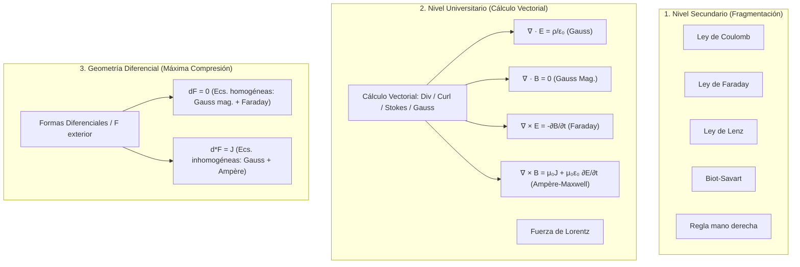

# How I Learn Difficult Things - Eero Alvar

## Síntesis

En este ensayo audiovisual, **Eero Alvar** expone su filosofía y metodología fundamental para asimilar temas técnicos de alta complejidad (matemática, física, ingeniería de software). Su tesis central redefine qué significa "comprender": **comprender no es acumular proposiciones aisladas en la memoria para responder preguntas, sino construir un grafo mental de dependencias conexo**, donde unas pocas verdades esenciales actúan como generadores a partir de los cuales se puede deducir, reconstruir y verificar todo el dominio conceptual.

> [!IMPORTANT] Tesis Central: Comprensión como Grafo Generativo vs. Memorización Dispersa
> El conocimiento desconectado se pudre con el tiempo (*memorized facts rot*). El conocimiento comprendido se auto-preserva (*understood facts don't*), porque no se sostiene como un dato suelto en la memoria estática, sino por la tensión estructural de sus **aristas de justificación** dentro de un modelo mental. El objetivo último del estudio no es memorizar respuestas, sino alcanzar **la compresión cognitiva (*the click*)**: el colapso de una maraña de hechos aparentemente arbitrarios en un puñado de principios generativos.

---

### 1. El Experimento Mental de los Dos Cerebros y la Anatomía del Entendimiento

Alvar propone un experimento conceptual para desenmascarar la ilusión de conocimiento: imaginemos dos cerebros que rinden el mismo examen técnico y obtienen exactamente el mismo puntaje perfecto:

* **Cerebro A (Almacén de Hechos Aislados):** Contiene una colección masiva de proposiciones memorizadas independientemente. Ante una pregunta, accede directamente al casillero de memoria correspondiente y devuelve la respuesta correcta.
* **Cerebro B (Grafo Generativo de Dependencias):** Almacena únicamente un pequeño conjunto de verdades nucleares y las reglas lógicas mediante las cuales esas verdades se conectan. Ante una pregunta, deriva el resultado mediante razonamiento estructurado.

Desde el exterior, ambos cerebros son funcionalmente indistinguibles en una evaluación estandarizada superficial. Sin embargo, su arquitectura interna es opuesta:

| Dimensión | Cerebro A: Memorización Aislada | Cerebro B: Grafo Generativo |
| :--- | :--- | :--- |
| **Estructura topológica** | Nodos huérfanos y disjuntos. | Grafo acíclico dirigido (DAG) de dependencias. |
| **Mantenimiento mental** | Requiere repetición forzada constante; decae por entropía (*rot*). | Se auto-preserva mediante soporte mutuo de aristas. |
| **Resiliencia ante el olvido** | Fallo catastrófico: si el dato se borra, no hay forma de recuperarlo. | Regeneración algorítmica: si un nodo se olvida, se recalcula desde sus padres. |
| **Transferencia y adaptación** | Inerte: no puede resolver problemas fuera de lo memorizado. | Altamente elástico: extrapola y generaliza a dominios adyacentes. |

**Componentes del modelo formal:**
* **Nodo:** Un hecho, definición, fórmula, ley o concepto discreto.
* **Arista:** Una relación causal, deductiva o motivacional que justifica por qué un nodo se desprende o se apoya en otro ("porque...", "se deduce de...", "generaliza a...").
* **Comprensión:** La existencia de aristas justificadas entre los nodos. Sin aristas no hay entendimiento; solo hay retención pasiva.

---

### 2. Principio 1: Verdades Incondicionales Primero (*Unconditional Truths First*)

El primer principio metodológico exige **anclar el aprendizaje desde el suelo firme**: asegurar verdades que la mente pueda aceptar de inmediato, al pie de la letra y sin necesidad de salvedades o notas al pie.

#### ¿Por qué empezar por la base?
Alvar aclara un punto crucial: empezar desde abajo **no se elige porque el orden *bottom-up* sea el único camino lógico posible**, sino por un **mecanismo neuropsicológico de compromiso**:
> *"El cerebro no se compromete plenamente a asimilar un hecho si sospecha que más adelante algo más fundamental vendrá a contradecirlo."*

Cuando un dato viene cargado de excepciones opacas ("bueno, esto es así en general, salvo en casos especiales..."), el cerebro *cobertura* (*hedging*): posterga la asimilación profunda y no lo consolida para evitar el costo de una reestructuración forzada posterior. Las verdades incondicionales eliminan este riesgo: al ser seguras e inmutables, la mente las bloquea (*lock-in*) al instante sin reservas cognitivas.

#### Distinción Crítica: Verdad Incondicional vs. Axioma
Alvar insiste en no abusar del término "axioma":
* **Verdad Incondicional:** Es una propiedad de **cómo la mente sostiene el hecho**. Es una afirmación que el aprendiz puede aceptar *tal cual, sin matices ni condiciones*. Puede derivar de algo más profundo, pero no necesita esa derivación para ser aceptada con absoluta certidumbre en ese momento.
* **Axioma:** Es una propiedad de **dónde se ubica el nodo en el grafo**. Es estrictamente un nodo raíz sin aristas entrantes (primer principio irreductible).

Todo axioma libre de matices es una verdad incondicional, pero muchas verdades incondicionales no son axiomas fundacionales; simplemente son proposiciones que operan como suelo sólido e indiscutible para el aprendiz.

#### Formas Fuertes de Verdades Incondicionales
1. **Afirmaciones Universales:** Proposiciones del tipo *"Todo X es Y"* o *"Ningún X es Y"*. Al no admitir excepciones, el cerebro no tiene que gestionar casos límite de entrada.
2. **Unidades Atómicas de Dominio:** Declaraciones estructurales que unifican el medio operativo (*"TODA la comunicación entre computadoras en Internet se realiza mediante {el envío de paquetes}"* o *"TODO cambio en el flujo magnético induce {una fuerza electromotriz}"*).

---

### 3. Principio 2: Descubrimiento Motivado (*Motivated Discovery*)

El segundo principio combate la sensación de **arbitrariedad técnica**. Cuando a un estudiante se le presenta una fórmula o definición compleja sin contexto, la mente la percibe como una convención caprichosa, dificultando su retención duradera.

El **descubrimiento motivado** consiste en desarmar el hecho consumado y reconstruir el camino cognitivo de su creador:
* **La pregunta de origen:** ¿Qué problema concreto o anomalía experimental obligó a formular esta pregunta?
* **La motivación de la herramienta:** ¿Por qué se eligió precisamente esta definición, esta sustitución o este artificio matemático y no otra alternativa más intuitiva?
* **La deducción paso a paso:** ¿Cómo se deriva lógicamente este paso a partir de lo que ya aceptamos como verdades previas?

Alvar cita explícitamente a **Grant Sanderson (3Blue1Brown)** como el paradigma de este estilo: la explicación brillante no es la que exhibe la elegancia formal de una demostración acabada, sino la que hace que el resultado final parezca **inevitable y natural**.

---

### 4. El "Click" como Compresión Cognitiva (*The Click as Compression*)

La experiencia subjetiva de entender algo súbitamente —el célebre "click" intuitivo— tiene una explicación rigurosamente computacional: **es un fenómeno de compresión algorítmica de la información**.

* **Antes del "click":** La mente carga con docenas de datos dispersos, fórmulas aisladas y procedimientos de memoria. Cada pieza consume energía atencional y compite en la memoria de trabajo.
* **Durante el "click":** Ese cúmulo heterogéneo colapsa en un número mínimo de principios generadores fundamentales.
* **Después del "click":** La cantidad de información efectiva no ha disminuido (es la misma o mayor), pero el número de **partes móviles independientes se reduce drásticamente**. El conocimiento ahora es generativo: basta recordar dos o tres generadores para reconstruir el sistema entero en segundos.

---

### 5. Caso de Estudio: Electromagnetismo (De la Secundaria a las Formas Diferenciales)

Alvar ejemplifica la compresión estructural comparando cómo se enseña el electromagnetismo en tres etapas de madurez:

* **Secundaria:** Una constelación de fórmulas inconexas que deben ser memorizadas individualmente, con reglas mnemotécnicas auxiliares. Alta fricción y baja retención.
* **Universidad:** Al introducir la maquinaria del cálculo vectorial (divergencia, rotor, teoremas de Green/Stokes/Gauss), decenas de casos particulares colapsan en las **cuatro ecuaciones de Maxwell más la fuerza de Lorentz**. Paradójicamente, aunque la matemática es más avanzada, **el dominio es más fácil de sostener mentalmente** porque está comprimido.
* **Geometría Diferencial:** Con formas diferenciales y cálculo exterior, las cuatro ecuaciones vectoriales de Maxwell se comprimen a únicamente **dos ecuaciones compactas**:
  $$dF = 0 \quad \text{y} \quad d*F = J$$
  La compresión es máxima: todo el electromagnetismo clásico se deduce de la derivada exterior y el operador dual de Hodge sobre el tensor de campo electromagnético.

---

### 6. La Frontera del Entendimiento (*The Edge of Understanding*)

El aprendizaje real solo ocurre en una zona muy estrecha: **la frontera exacta donde lo que se sabe con absoluta certeza se encuentra con lo que todavía no se comprende** (análogo a la Zona de Desarrollo Próximo de Vygotsky y a las *dificultades deseables* de Bjork).

* **Por debajo de la frontera (demasiado fácil):** El material confirma lo que ya se sabe; no crea aristas nuevas en el grafo (cero aprendizaje).
* **Por encima de la frontera (demasiado difícil):** El material no encuentra ningún nodo previo donde conectarse; al no haber anclaje, el cerebro no puede justificarlo y lo rechaza o se ve forzado a la memorización mecánica ciega.
* **En la frontera (óptimo):** Existe suficiente base para construir aristas motivadas hacia un nuevo nodo.

> [!TIP] Dificultad Focalizada vs. Fricción Logística
> Alvar enfatiza: *"Queremos maximizar el esfuerzo cognitivo (*struggle*), pero ese esfuerzo debe estar invertido exclusivamente en la asimilación del material conceptual, jamás en la logística, la planificación, la búsqueda caótica de recursos o la duda sobre la veracidad de los hechos."*

---

## Reflexiones y Citas Textuales Clave

> "Understanding is the connections between facts, not the facts themselves. Two brains can hold the same propositions... but one holds a pile of disconnected lone facts, while the other holds a few core truths from which all those facts are derivable. That connection is understanding."
> — *Eero Alvar*

> "The brain won't fully commit to a fact it isn't sure is safe to lock in. If something more fundamental might later contradict it, committing is risky — it would force an expensive update. So the brain hedges, and the fact never really lands."
> — *Eero Alvar*

> "Start with unconditional truths not because bottom-up is always the logically correct order, but because unconditional truths are simply the easiest thing for the brain to accept and lock in without reservation."
> — *Eero Alvar*

> "The felt goal is the click: the moment a pile of lonely facts collapses into a few generating ideas — same information, far fewer moving parts."
> — *Eero Alvar*

> "We want to learn difficult things, so struggling is very important, but it has to be in the material itself and not in logistics, planning, finding resources, verifying facts, figuring out what to learn and in what order."
> — *Eero Alvar*

---

## Conexiones con la Bóveda y el Ecosistema Local

* **La Trilogía Epistémica de Eero Alvar:**
  1. `[[Second brain setup for doing]]` (Abril 2026): Gestión del estado cognitivo, evacuación de ideas vs. construcción de conocimiento, y las notas como **[[Artefactos de Transferencia]]**.
  2. `[[How I Learn Difficult Things - Eero Alvar]]` (Julio 2026 — Esta nota): Epistemología del aprendizaje, comprensión como grafo generativo conexo, verdades incondicionales, descubrimiento motivado y compresión ("el click").
  3. `[[Systems Building Systems - Eero Alvar]]` (Junio 2026 / Agosto 2026): Escalado de agentes, fábricas de software (*spec-to-ship*), *The Aiming Problem* vs. *Slop* y el patrón *Babysitter Agent* para preservar la ventana de contexto.
* **Correspondencia con la Arquitectura Local de Pi Agent (`amosblomqvist/learn`):**
  - Esta misma filosofía fue codificada por Alvar en el skill canónico `skills/teach/SKILL.md` de su repositorio `amosblomqvist/learn`, ejecutado sobre Pi Agent mediante el flujo de tres fases:
    1. **Probe (Sondaje):** Búsqueda binaria de la frontera (*edge of understanding*) mediante preguntas graduadas de opción múltiple con `quiz` y `ask_user_question`.
    2. **Plan (Planificación):** Mapeo de dependencias en un grafo Mermaid donde las raíces son verdades incondicionales auditadas por subagentes verificadores (`researcher`).
    3. **Teach (Enseñanza):** Avance lento y motivado nodo por nodo, con retroalimentación continua para evitar el auto-engaño cognitivo (*gaslighting*).
* **Convergencia Neurobiológica (`[[Aprendizaje Basado en Neurociencia]]`):**
  - La compresión de Alvar coincide con la consolidación sináptica descrita por Stanislas Dehaene: la atención selectiva delimita los nodos, la formulación de hipótesis (descubrimiento motivado) activa la señal de error dopaminérgica del estriado, y el "click" refleja la reorganización macroscópica neocortical donde la representación distribucional se optimiza minimizando energía libre.
* **Alineación con el Perfil Cognitivo y Volitivo (`[[ME]]` e `[[Intereses de primer y segundo orden]]`):**
  - Para un perfil analítico `Ti-Ne` (o `Ni-Te`), el peligro latente es saltar a aprender temas avanzados sin afianzar las verdades incondicionales (construir sobre arena) o acumular notas fragmentarias sin integrarlas en un grafo generativo.
  - El criterio de Alvar exige disciplina praxeológica: no dar por entendido un concepto hasta ser capaz de derivarlo deductivamente desde sus fundamentos incondicionales.

---

## Referencias

* Video original: [Eero Alvar — How I Learn Difficult Things (YouTube)](https://www.youtube.com/watch?v=ciC6ffUqI8k)
* Repositorio de implementación en Pi: [amosblomqvist/learn (GitHub)](https://github.com/amosblomqvist/learn)
* Video de implementación complementaria: [Eero Alvar — How I Use AI to Learn Things (YouTube)](https://www.youtube.com/watch?v=kzcI5F4tGiU)
* Enlaces conceptuales internos:
  - `[[Systems Building Systems - Eero Alvar]]`
  - `[[Second brain setup for doing]]`
  - `[[Aprendizaje Basado en Neurociencia]]`
  - `[[Artefactos de Transferencia]]`
  - `[[Toma de notas]]`
  - `[[Conocimiento]]`
  - `[[Curriculum Personal]]`
  - `[[El desafío de seleccionar contenido]]`
  - `[[ME]]`