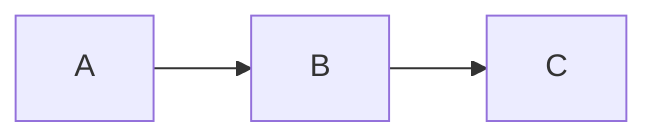

# Preguntas Generadoras de Escritura

```abc
E G B B B F A E G A S
```

$$\Sigma\ fancy!\ \pi$$
## Preguntas de Mi Interés Actual
- ¿Cómo se relaciona Concepto A con Concepto B?
- ¿Por qué Principio X no se aplica en Contexto Y?
- ¿Qué pasaría si combinara [Metodología A] con [Metodología B]?

**Para Cada Pregunta**:
- Deep Research question → Ejecutar en Perplexity
- Documentar insights
- Evaluar: ¿hay artículo/ensayo aquí?[^1]

# Archivo de Preguntas Generadoras

## Preguntas Activas (en exploración)
- ?Cómo [pregunta]? → Vinculada a [MOC Relevante]

## Preguntas Resueltas (convertidas en escritura)
- ?Cómo [pregunta]? ✓ → Convirtió en [Artículo X]

[^1]: es increíble
